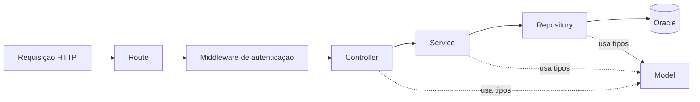

# Padrão de desenvolvimento da API

Este guia descreve a organização das entidades da API. O fluxo de perfil é o
exemplo de referência. O fluxo de uma requisição é:

O middleware pode ser associado às rotas que exigem autenticação. Ele valida o
token e fornece a identidade verificada ao controller; uma rota pública não
precisa dele. No fluxo de perfil, essa identidade vem de `res.locals.identity`,
nunca de um UID enviado no corpo da requisição.

## Models

Em `server/src/models`, declare entidades e contratos de entrada, saída e
persistência usados pelas outras camadas. Mantenha nomes em inglês e represente
campos opcionais ou nulos conforme o domínio. O model não recebe objetos Express,
não executa consultas e não converte erros em respostas HTTP. Consulte
[`profile.ts`](../server/src/models/profile.ts).

## Routes

Em `server/src/routes`, crie um `Router`, associe os middlewares necessários e
encaminhe cada método e caminho ao handler do controller. Não coloque validação,
consultas, regras de negócio ou formatação de resposta na rota. Veja
[`profile.ts`](../server/src/routes/profile.ts).

## Controllers

Em `server/src/controllers`, receba requisições, valide o conteúdo fornecido e
extraia somente os dados permitidos. Chame o service usando a identidade obtida
do middleware. Converta resultados e erros em status e mensagens HTTP sem expor
detalhes internos. Não escreva SQL nem acesse diretamente o banco. A validação
de nickname e data de nascimento em [`profile.ts`](../server/src/controllers/profile.ts)
é o exemplo atual.

## Services

Em `server/src/services`, implemente e coordene a lógica necessária para a
operação, usando models e repositories. O service não recebe `Request` ou
`Response` e não determina status HTTP. A fábrica
[`createProfileService`](../server/src/services/profile.ts) recebe o contrato
do repository e expõe operações ao controller. Atualmente essas operações são
simples delegações; regras de negócio futuras devem ser adicionadas aqui.
O service de Firebase é uma integração separada utilizada pelo middleware.

## Repositories

Em `server/src/repositories`, concentre as consultas, parâmetros, mapeamento de
resultados e persistência. Use parâmetros vinculados em SQL e feche conexões.
Informe falhas ou conflitos à camada superior sem emitir respostas HTTP. O
repository de perfil também sincroniza e-mail e nome ao buscar o perfil; esse é
um comportamento existente que deve ser considerado ao alterá-lo. Veja
[`profiles.ts`](../server/src/repositories/profiles.ts).

## Composição, erros e testes

Monte as dependências no ponto de entrada, como em
[`app.ts`](../server/src/app.ts): repository → service → controller → route.
Use funções e fábricas com dependências explícitas para permitir testes isolados.
O middleware de autenticação deve ser associado antes dos handlers protegidos.

O controller transforma erros conhecidos em respostas adequadas e usa mensagens
genéricas para falhas inesperadas. Ao implementar uma entidade, teste os fluxos
HTTP relevantes: autenticação quando aplicável, entrada inválida, sucesso,
recurso ausente, conflito e falha de persistência. Use substitutos para
integrações externas em testes automatizados e informe separadamente quando a
integração real não tiver sido verificada.
