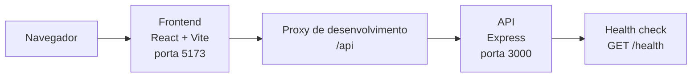
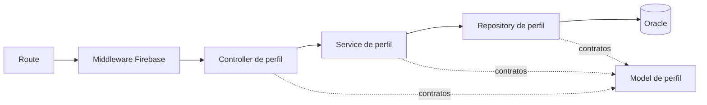

# Arquitetura

Este documento é a referência de arquitetura para quem contribui com o RPG
Combat Manager. Ele separa o estado já implementado da direção definida para a
evolução do projeto.

## Visão geral

O sistema é uma aplicação full-stack formada por um frontend React e uma API
Express. Durante o desenvolvimento, os dois serviços são executados pelo Docker
Compose.

O navegador acessa o frontend em `http://localhost:5173`. Requisições para
`/api` são encaminhadas pelo proxy do Vite para o serviço `server` na rede do
Docker Compose, removendo o prefixo `/api`. Por isso,
`/api/health` no frontend chega a `GET /health` na API.

O Compose expõe a API diretamente em `127.0.0.1:3000`, mantém os
`node_modules` de cada serviço em volumes separados e só inicia o frontend
depois que o health check da API estiver saudável.

## Estado atual

### Frontend

O frontend usa React e Vite. A aplicação oferece acesso offline e autenticação
Firebase, com cadastro e edição de perfil pela API. Os dados de combate
continuam locais.

### API

A API usa Express. Ela disponibiliza `GET /health`, que responde
`{ "status": "ok" }`, e responde `404` com `{ "error": "Not found" }` para
rotas não encontradas. A API valida tokens Firebase e persiste perfis no Oracle;
ainda não implementa regras de negócio de combate.

## Arquitetura de evolução

### Frontend: componentes e páginas

O frontend seguirá uma arquitetura orientada a componentes baseada no modelo
atômico. Os componentes devem ser tão pequenos e coesos quanto possível, sem
concentrar lógica de negócio ou regras específicas de uma tela. Devem apresentar
dados e expor eventos por propriedades e callbacks; a lógica associada a esses
eventos deve ser aplicada nas páginas. Assim, os mesmos componentes podem ser
reutilizados em diferentes funcionalidades e contextos.

- **Páginas** compõem a interface de cada tela, administram estado e concentram
  regras e comportamentos específicos daquela tela.
- **Componentes reutilizáveis** são unidades pequenas de apresentação, recebem
  dados e callbacks por propriedades e comunicam interações por eventos.
- Regras particulares de uma página não devem ser acopladas a componentes
  reutilizáveis.

Ao adicionar uma funcionalidade, a página deve ser o ponto de integração entre
estado, comportamentos da tela e componentes visuais.

Para cada nova funcionalidade do frontend ou alteração em uma funcionalidade
existente, deve ser criado ou atualizado ao menos um teste que cubra o
comportamento implementado ou modificado.

### Estilização e identidade visual

O Tailwind CSS deve constituir a abordagem preferencial para a implementação
de estilos no frontend, em razão de sua capacidade de promover consistência e
composição eficiente da interface. Essa preferência não é absoluta: outra
solução de estilização pode ser adotada quando se mostrar tecnicamente mais
adequada ao contexto da funcionalidade.

As interfaces devem priorizar uma identidade visual associada à fantasia, em
consonância com a natureza de um sistema de gerenciamento de combates de RPG
por turnos. Essa diretriz deve orientar escolhas de composição, elementos
visuais e linguagem de interface, sem comprometer legibilidade, acessibilidade
ou usabilidade.

### API: MVC

A API segue as seguintes camadas:

| Camada | Responsabilidade |
| --- | --- |
| `routes` | Definir endpoints e encaminhar requisições aos controllers. |
| `controllers` | Validar requisições, acionar services e preparar respostas HTTP. |
| `services` | Implementar regras de negócio. |
| `repositories` | Acessar e persistir dados. |
| `models` | Definir entidades e estruturas do domínio. |

O fluxo esperado é: a rota encaminha a requisição ao controller, o controller
delega a regra de negócio a um service, e o service usa repositories e models
quando necessário. Cada camada deve manter sua responsabilidade, sem pular
diretamente para preocupações de outra camada.

No fluxo de perfil, a composição é feita em `server/src/app.ts`:

O [guia das camadas da API](api-layers.md) detalha como implementar novas
entidades, as responsabilidades de cada camada e os testes esperados.
Para cada nova funcionalidade da API ou alteração em uma funcionalidade
existente, deve ser criado ou atualizado ao menos um teste que cubra o
comportamento implementado ou modificado.

## Convenções para contribuições

- Identificadores de código, incluindo variáveis, funções, classes, tipos,
  arquivos e símbolos equivalentes, devem ser escritos em inglês.
- A interface de usuário e a documentação do projeto devem ser redigidas em
  português formal.
- Preserve o frontend e a API como aplicações independentes, conectadas pelo
  prefixo `/api` durante o desenvolvimento.
- Coloque lógica de tela nas páginas e mantenha componentes reutilizáveis sem
  dependência de regras de negócio específicas.
- Ao criar funcionalidades da API, respeite as fronteiras entre routes,
  controllers, services, repositories e models.
- Atualize este documento quando uma decisão arquitetural mudar ou quando uma
  nova área passar a exigir documentação própria.

## Operação local

O ambiente é iniciado com Docker Compose e usa hot reload por bind mounts. Os
comandos de inicialização, logs, reinicialização e encerramento estão no
[README](../README.md). Consulte-o para os detalhes operacionais completos.

## Próximos documentos

Este é o documento único de arquitetura enquanto o projeto permanece pequeno.
Quando o frontend ou a API acumularem decisões próprias relevantes, podem ser
adicionados documentos específicos, como `frontend-architecture.md` ou
`backend-architecture.md`, sem duplicar a visão geral mantida aqui.

### Autenticação e persistência

O frontend usa Firebase Authentication para e-mail/senha e Google. A API
valida o ID token Bearer com Firebase Admin e usa o UID verificado para acessar
o perfil no Oracle por node-oracledb Thin. O cadastro exige perfil com nickname
e data de nascimento; para senha, também exige e-mail verificado. A API fornece
GET, POST e PUT em `/profile` para o próprio usuário. O health check não
verifica as dependências externas.

As migrations SQL são executadas manualmente pelo contêiner Flyway. O índice
do UID é único, o nickname tem índice único sem distinção de caixa e o e-mail
tem índice próprio. A configuração Web do Firebase é pública no navegador;
credenciais de banco e arquivos locais são ignorados pelo Git.